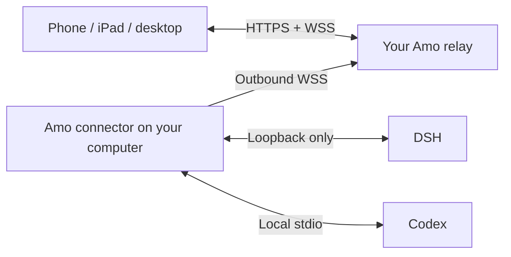

<div align="center">
  
  <h1><strong>Amo</strong> · 阿萌</h1>
  <p><strong>Agent Remotify</strong></p>
  <p><strong>Your coding agents. Your machine. Anywhere.</strong></p>
  <p><a href="README.zh-CN.md">简体中文</a> · English · <a href="docs/INSTALL_AGENT.md">Install with an Agent</a></p>
</div>

Amo is a self-hosted remote workspace for **DeepSeek Harness (DSH)** and **Codex**. Continue a coding conversation from your phone, iPad or desktop browser while your agents, project files and model credentials stay on your own computer.

This is an early release. The browser client and native adapters evolve together; use the same Amo revision for your relay and connectors.

## What you can do

- Find conversations across projects by recent activity, or browse by directory; filter DSH and Codex independently.
- Create, rename and branch conversations, with clear agent identity and live execution status.
- Follow streamed replies, available reasoning summaries and tool activity; collapse an entire reply from its bottom edge.
- Send follow-up instructions into a shared queue. Edit text and append attachments before dispatch; editing pauses that queued item. Long-press a queued message to guide the current task.
- Paste screenshots, attach files, browse project files and inspect grouped changes.
- Use a growing composer, saved local drafts, compact controls and multiple visual layouts on touch and desktop devices.
- Check available DSH balance and Codex usage limits, with details supplied by the native account.
- Connect multiple computers through device pairing; install the website to your home screen.

**Native ownership matters.** A Codex conversation held by another native client can be read-only. Amo cannot force simultaneous write access; start a remote-owned conversation or branch a completed reply. Amo shows only reasoning content exposed by the native history; it cannot reconstruct hidden or unavailable reasoning. New Amo-owned Codex conversations support user questions; older conversations depend on their native tool configuration.

## How it connects



The **relay** serves the website and routes authenticated traffic. The **connector** runs beside your agents and initiates an outbound connection. Your computer does not need a public IP or an inbound port. The relay can run on a small server, or on the same machine for a local trial.

Model calls and execution happen on the agent computer. The relay carries conversation traffic, so deploy it on infrastructure you trust; it does not persist conversation history. Native account credentials and plugin configuration are not forwarded to the relay. Account usage is shown as a bounded summary.

## Install with your coding Agent

Copy this prompt into your coding assistant:

```text
Install Amo from https://github.com/Laka-3DV/amo into a new directory.
Read README.md and docs/INSTALL_AGENT.md before making changes.
First determine whether I want a local trial, to connect my computer to an
existing relay, or to deploy my own HTTPS relay. Ask only for missing setup
information. Use the documented source installation and public Amo CLI.
Use my own local DSH/Codex login; keep all generated credentials and device
configuration outside Git. Never reuse someone else's host, IP, password
or token. Verify the build and connection without sending model prompts.
On macOS, optionally configure the documented LaunchAgent; do not restart
an active existing connector. Report the access URL, configuration locations
and verification result, without printing credentials into logs.
```

The [Agent installation guide](docs/INSTALL_AGENT.md) includes an equivalent Chinese prompt and the steps for each installation mode.

## Local trial

Prerequisites: **Python 3.12+**, **Node.js 22.12+** (24 recommended), and at least one configured local agent. The DSH adapter is tested with `@deepseek-ai/dsh@0.2.0-rc.2`; start its Web carrier on loopback with `npx @deepseek-ai/dsh@0.2.0-rc.2 web`. Codex uses its locally installed CLI and your own `codex login`; tested CLI versions include `0.159.2` and the desktop-bundled `0.162.0-alpha.17.2`. Native upgrades may require adapter updates.

```bash
git clone https://github.com/Laka-3DV/amo.git
cd amo
python3 -m venv .venv
source .venv/bin/activate
python -m pip install -r requirements.txt
npm --prefix web ci
npm --prefix web run build
python -m amo init
```

`init` creates a private `.env` with independently generated random credentials and refuses to overwrite an existing file. Obtain your browser login password from `LOGIN_PASSWORD` in this local file. Do not share the file or add it to Git.

Run in two terminals from the repository, with the virtual environment activated:

```bash
# Terminal 1
python -m amo relay
```

```bash
# Terminal 2
python -m amo connector
```

Open **http://127.0.0.1:8765**. Plain HTTP is for loopback testing; use HTTPS for remote access, clipboard features and home-screen installation.

## Connect to an existing relay

You need its **HTTPS URL**, your own authorized web account, and a short-lived pairing code from **Device Center**. You do not need another person's computer IP, model credentials or server administration access.

```bash
git clone https://github.com/Laka-3DV/amo.git
cd amo
python3 -m venv .venv
source .venv/bin/activate
python -m pip install -r requirements-wrapper.txt
PYTHON_DOTENV_DISABLED=1 python -m amo pair https://amo.example.com YOUR_PAIRING_CODE --name "My Mac"
PYTHON_DOTENV_DISABLED=1 python -m amo connector
```

Replace the example URL and pairing code with your own. Pairing writes private device configuration to `~/.amo/device.json` with mode `0600`; state is stored under `~/.amo`. A shared relay administrator must configure separate user accounts and machine access lists when users need isolation.

For macOS background operation, use [the macOS installation instructions](deploy/README.md#macos-connector). For a new server, follow [relay deployment](deploy/README.md#https-relay).

## Configuration

| Setting | Purpose |
|---|---|
| `PUBLIC_ORIGIN` | Exact HTTPS browser origin for a public relay |
| `LOGIN_PASSWORD` | Single-owner web login; generated locally |
| `SESSION_SECRET` | Session-signing secret; generated locally |
| `WRAPPER_TOKEN` | Connector-to-relay credential; generated locally or paired |
| `LOGIN_USERS_JSON` / `WRAPPER_TOKENS_JSON` | Independent users, device credentials and access lists |
| `RELAY_URL` | Connector's WSS endpoint; pairing can supply it |
| `AMO_HOME` | Private state directory; defaults to `~/.amo` |
| `AMO_MACHINE_ID` | Device routing ID |
| `AMO_DSH_URL` | DSH loopback carrier; defaults to `http://127.0.0.1:3080` |
| `AMO_CODEX_ENABLED` / `AMO_CODEX_BIN` | Enable Codex or select a local executable |

See [.env.example](.env.example). All public endpoints are supplied by configuration. Local loopback addresses and synthetic test addresses are intentional, not live deployment endpoints.

## Development

```bash
python -m pip install -r requirements-dev.txt
python -m pytest tests/
npm --prefix web run build
npm --prefix web run test:reliability
npm --prefix web run lint
# For browser interaction tests:
npm --prefix web exec -- playwright install chromium webkit
npm --prefix web run test:sidebar
```

Unit and fixture tests do not call models. Live native acceptance tests require an explicit isolated test session. See [AGENTS.md](AGENTS.md) for contributor boundaries.

## License

[MIT](LICENSE). Amo is independent of the agent providers and is not an official DSH or OpenAI product. Agent names and marks identify their respective integrations.
