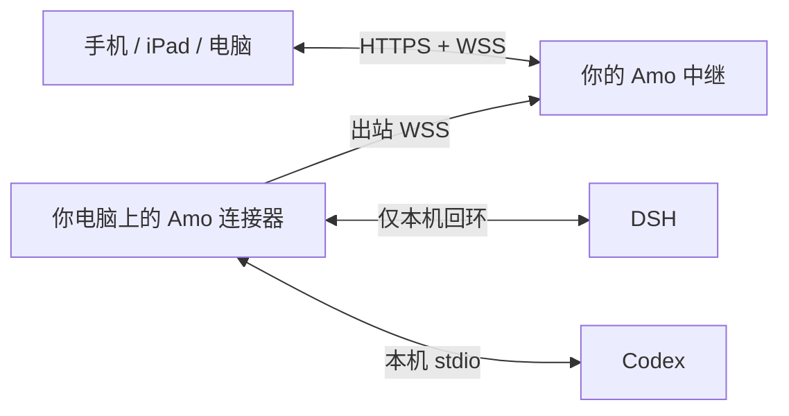

<div align="center">
  
  <h1><strong>Amo</strong> · 阿萌</h1>
  <p><strong>Agent Remotify</strong></p>
  <p><strong>你的 Agent，你的电脑，随时继续。</strong></p>
  <p>简体中文 · <a href="README.md">English</a> · <a href="docs/INSTALL_AGENT.md">让 Agent 帮你安装</a></p>
</div>

Amo 是面向 **DeepSeek Harness（DSH）** 和 **Codex** 的自托管远程工作台。你可以在手机、iPad 或电脑浏览器上继续编程对话，Agent、项目文件与模型凭据仍保留在自己的电脑上。

目前是早期版本。网页与本机适配器会一起演进，中继与各台电脑的连接器应使用相同的 Amo 版本。

## 能做什么

- 跨项目按最近活跃查找会话，或按目录浏览；独立筛选 DSH 和 Codex。
- 新建、重命名、派生会话，清楚区分 Agent 类型与执行状态。
- 查看流式回复、原生可见的思考摘要和工具过程，从末尾收起整轮回答。
- 后续消息默认进入共享队列；发送前可修改文字、追加附件。编辑时暂停该条消息，长按可以选择引导当前任务。
- 粘贴截图、上传文件、浏览项目文件，集中查看改动。
- 使用自动增长的输入区、本地草稿缓存、紧凑操作栏和多种界面布局。
- 查看本机账号提供的 DSH 余额、Codex 额度及详情。
- 用设备配对连接多台电脑，将网页保存到手机主屏幕。

**注意原生会话的写入权。** 被其他原生客户端持有的 Codex 会话可能只读，Amo 无法强制让多个客户端同时写入。可新建由远程端持有的会话，或从已完成回复派生。思考过程以原生历史实际提供的内容为准，无法补造隐藏或缺失的正文。Amo 新建的 Codex 会话支持提问，旧会话则取决于其原生工具配置。

## 连接方式



**中继**负责网页和认证后的消息转发，**连接器**运行在 Agent 所在电脑上，主动连接中继。因此，你的电脑不需要公网 IP，也不需要开放入站端口。中继可以放在小型服务器上，本地试用时也可以和连接器放在同一台电脑上。

模型调用和执行都在 Agent 电脑上进行。对话流量会经过中继，应部署在自己信任的基础设施上；中继不持久化会话历史，原生账号凭据和插件配置不会转发到中继。余额与额度仅以受限摘要形式展示。

## 直接让 Agent 安装

把下面的 prompt 复制给你的编程助手：

```text
请将 https://github.com/Laka-3DV/amo 克隆到一个新目录并安装 Amo。
先阅读 README.zh-CN.md 和 docs/INSTALL_AGENT.md。
先确定我需要“本地试用”“接入已有中继”还是“部署自己的 HTTPS 中继”，
只询问缺失的配置信息，按文档使用源码安装与 Amo 命令入口。
使用我自己的本机 DSH/Codex 登录，不复用其他人的主机、IP、密码或 token。
生成的凭据和设备配置必须留在 Git 之外。验证构建和连接时不要发送模型任务。
如果我需要 macOS 后台运行，按文档配置 LaunchAgent；已有连接器正在执行任务时
不要重启它。完成后告诉我访问地址、配置保存位置和验证结果，日志里不要打印凭据。
```

[Agent 安装指南](docs/INSTALL_AGENT.md)提供三种模式的具体步骤和英文 prompt。

## 本地试用

需要 **Python 3.12+**、**Node.js 22.12+**（推荐 24）以及至少一个已配置的本机 Agent。DSH 适配版本为 `@deepseek-ai/dsh@0.2.0-rc.2`，可运行 `npx @deepseek-ai/dsh@0.2.0-rc.2 web`，确认只监听本机回环地址。Codex 使用本机 CLI 和你自己的 `codex login`；已测试 CLI `0.159.2` 及桌面随附的 `0.162.0-alpha.17.2`。升级原生 Agent 后可能需要同步升级适配器。

```bash
git clone https://github.com/Laka-3DV/amo.git
cd amo
python3 -m venv .venv
source .venv/bin/activate
python -m pip install -r requirements.txt
npm --prefix web ci
npm --prefix web run build
python -m amo init
```

`init` 会生成含随机凭据的私人 `.env`，并拒绝覆盖已有文件。浏览器登录密码保存在该文件的 `LOGIN_PASSWORD` 中，请在本机查看，不要分享或提交这个文件。

从项目目录打开两个终端，分别激活虚拟环境后运行：

```bash
# 终端一
python -m amo relay
```

```bash
# 终端二
python -m amo connector
```

访问 **http://127.0.0.1:8765**。HTTP 只适用于本地回环测试；远程访问、剪贴板功能和主屏幕安装应使用 HTTPS。

## 接入已有中继

需要中继的 **HTTPS 地址**、属于你的网页账号，以及从**设备中心**生成的短时配对码。不需要知道别人的电脑 IP，不需要其模型凭据，也不需要服务器管理权限。

```bash
git clone https://github.com/Laka-3DV/amo.git
cd amo
python3 -m venv .venv
source .venv/bin/activate
python -m pip install -r requirements-wrapper.txt
PYTHON_DOTENV_DISABLED=1 python -m amo pair https://amo.example.com YOUR_PAIRING_CODE --name "我的 Mac"
PYTHON_DOTENV_DISABLED=1 python -m amo connector
```

替换示例域名和配对码。配对配置保存在 `~/.amo/device.json`，权限为 `0600`；本机状态保存在 `~/.amo`。多个人共用中继且需要相互隔离时，管理员必须设置独立账号、设备凭据与访问列表。

macOS 后台运行见[部署指南](deploy/README.md#macos-connector)，新服务器部署见 [HTTPS 中继](deploy/README.md#https-relay)。

## 配置

| 配置项 | 用途 |
|---|---|
| `PUBLIC_ORIGIN` | 公网中继的完整 HTTPS 浏览器源地址 |
| `LOGIN_PASSWORD` | 单人网页登录密码，本机随机生成 |
| `SESSION_SECRET` | 会话签名密钥，本机随机生成 |
| `WRAPPER_TOKEN` | 连接器凭据，可由本机生成或设备配对取得 |
| `LOGIN_USERS_JSON` / `WRAPPER_TOKENS_JSON` | 多用户、独立设备凭据与访问列表 |
| `RELAY_URL` | 连接器的 WSS 入口，可由配对提供 |
| `AMO_HOME` | 私人状态目录，默认 `~/.amo` |
| `AMO_MACHINE_ID` | 设备路由标识 |
| `AMO_DSH_URL` | DSH 本机回环入口，默认 `http://127.0.0.1:3080` |
| `AMO_CODEX_ENABLED` / `AMO_CODEX_BIN` | 启用 Codex 或指定本机可执行文件 |

参考 [.env.example](.env.example)。公网地址全部由配置提供；源码中的回环地址和合成测试地址不是实际部署入口。

## 开发与验证

```bash
python -m pip install -r requirements-dev.txt
python -m pytest tests/
npm --prefix web run build
npm --prefix web run test:reliability
npm --prefix web run lint
# 浏览器交互测试：
npm --prefix web exec -- playwright install chromium webkit
npm --prefix web run test:sidebar
```

单元和 fixture 测试不调用模型。原生联调必须使用独立的临时会话。贡献约定见 [AGENTS.md](AGENTS.md)。

## 许可证

[MIT](LICENSE)。Amo 独立于 Agent 提供方，并非 DSH 或 OpenAI 官方产品。界面中的 Agent 名称和标识用于识别对应集成。
